<p align="center">
  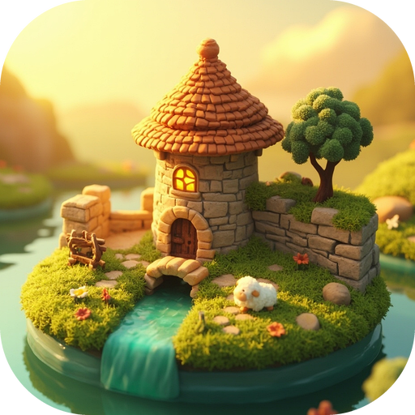
</p>

<h1 align="center">Tiny Glade</h1>

<p align="center">
  <b>100% 浏览器原生 AAA 级治愈系中世纪微缩景观建造游戏 — WebGL2 HDR、程序化砖石拱门与水桥、19.5 万株 GPU 风吹草甸、移轴景深与纯合成音效，浓缩于单个 930 KB HTML 文件</b>
</p>

<p align="center">
  <a href="README.md">English</a> •
  简体中文
</p>

<p align="center">
  <a href="https://cdn.firetable.tech/file/tiny-glade-aaa.html"><b>🌐 在线体验 (Live Demo)</b></a> •
  <a href="https://cdn.firetable.tech/file/tiny-glade-swarm-making-of.html"><b>📊 1h41m Swarm 全程复盘与上下文全景报告</b></a>
</p>

<p align="center">
  <a href="https://cdn.firetable.tech/file/tiny-glade-aaa.html"></a>
  <a href="https://cdn.firetable.tech/file/tiny-glade-swarm-making-of.html"></a>
  <a href="#-项目简介-overview"></a>
  <a href="tiny-glade-aaa.html"></a>
  <a href="LICENSE"></a>
</p>

---

> [!IMPORTANT]
> **单条提示词 AI 生成展示 (One-Prompt Showcase)**：本仓库完整的 AAA 级浏览器原生 3D 游戏——涵盖自定义 WebGL2 HDR 渲染管线、启动时实时合成的 PBR 材质贴图、逐块堆砌的响应式砖石与楔形拱石（Voussoir）拱门求解器、19.5 万株 GPU 风吹草甸、3D 实体拖拽手柄、第一人称漫步模式，以及 100% WebAudio 程序化拟音与中世纪竖琴/鲁特琴环境配乐——**全部由 Gemini 4 Carbon 通过单条提示词端到端生成**，**零外部图片、零外部 3D 模型、零外部音频文件**。
>
> * 📊 **1h41m Swarm 全程复盘与上下文全景报告**：查看交互式工程复盘报告（**[在线 CDN 报告](https://cdn.firetable.tech/file/tiny-glade-swarm-making-of.html)** · 本地文件 [`swarm-making-of.html`](swarm-making-of.html)）——完整拆解 9 个 Agent 交互式多轨甘特泳道图、`4.14×` 首轮峰值并行加速（`22,910` 行代码 `0` 合并冲突）、`256×256 RGBA16F` 共享技术契约、4 轮视觉与着色器 QA 闭环，以及 `#1`–`#34` 全量一字不改原始上下文档案。
>
> <details>
> <summary><b>💬 查看原始单次提示词 (Original One-Shot Prompt)</b></summary>
>
> ```text
> /swarm 请你做一个类似 tiny glade 游戏的 AAA 级别的游戏，画质要用上所有最新的手段，能在浏览器环境运行的， html 版本
> ```
> </details>

---

## 📖 项目简介 (Overview)

**Tiny Glade（浏览器原生版）** 是一款无网格束缚、极致治愈的 3D 中世纪城堡与草甸微缩沙盒建造游戏，100% 运行在单个浏览器标签页内——**零后端、零外部贴图/模型/音频网络请求，支持本地双击 `file://` 直接秒开**。

在起伏的绿茵山丘上随手拉出一段弯曲石墙，错落有致的石灰岩砖块便会伴随木琴般清脆治愈的堆砌音效逐层生长；用鹅卵石小径穿过石墙，墙体便会**自动雕刻出可穿行的 3D 放射状楔形拱石拱门（Voussoir Archway）**，拱顶石、门柱与严丝合缝的拱肩楔石一应俱全；把小径画过开凿出的池塘或蜿蜒溪流，一座**石砌护栏配弧形木扶手的石拱桥**便会自动横跨在清澈见底的 Beer-Lambert 水面之上，水畔泛起白色浪沫，睡莲、香蒲与划水天鹅相映成趣。

所有视觉材质与声学反馈均在启动瞬间由 JavaScript 与 GLSL ES 3.0 数学实时合成——整套游戏引擎、`three@0.170.0`、着色器、4 套精选微缩场景预设与 UI 完整打包在单个 **`929.6 KB`（`tiny-glade-aaa.html`）** 独立文件中，随处可发、双击即玩。

---

## 🖼️ 画面预览 (Preview)

<p align="center">
  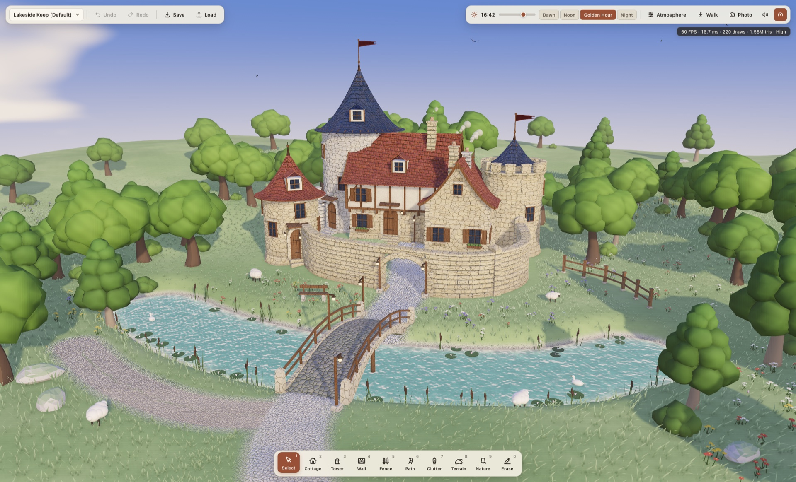<br/>
  <i>默认场景「湖畔城堡 (Lakeside Keep)」黄金时刻 —— 瑞利/米氏物理天空、GTAO 砖缝环境光遮蔽、移轴微缩景深、自动雕刻庭院石拱门、池塘石拱桥、三叶风吹草甸与绵羊</i>
</p>

<p align="center">
  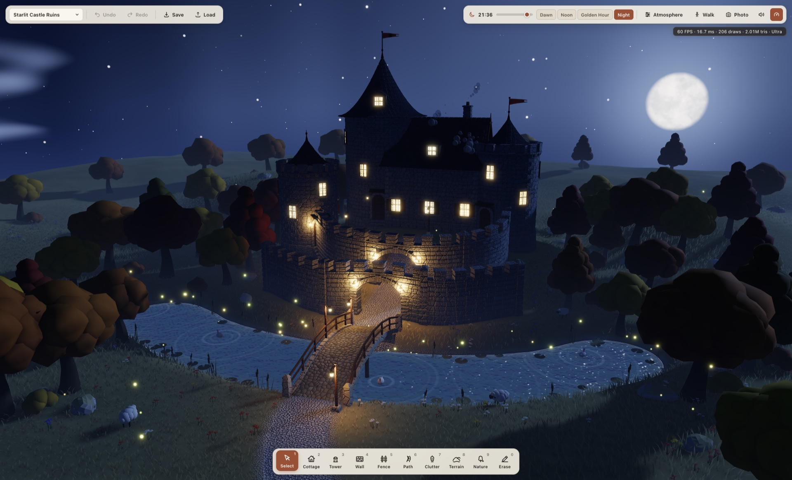<br/>
  <i>「星夜古堡 (Starlit Castle Ruins)」满月夜景 —— 环形山清晰可见的柔光满月、透出温暖烛光的格栅窗、照亮石墙肌理的动态灯笼点光源、月色波光与金色流萤</i>
</p>

### 🏰 响应式程序化建筑与生态细节展示

<table align="center">
  <tr>
    <td align="center" width="50%">
      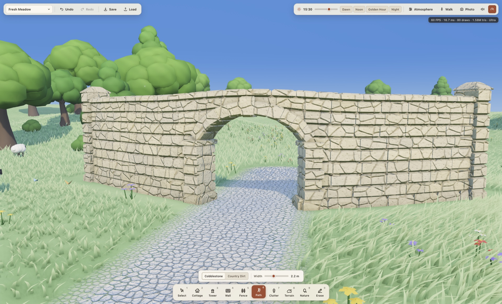<br/>
      <sub><b>自动雕刻 3D 石拱门</b> —— 放射状楔形拱石、凸出拱顶石、加固门柱与零漏光斜切拱肩砌体</sub>
    </td>
    <td align="center" width="50%">
      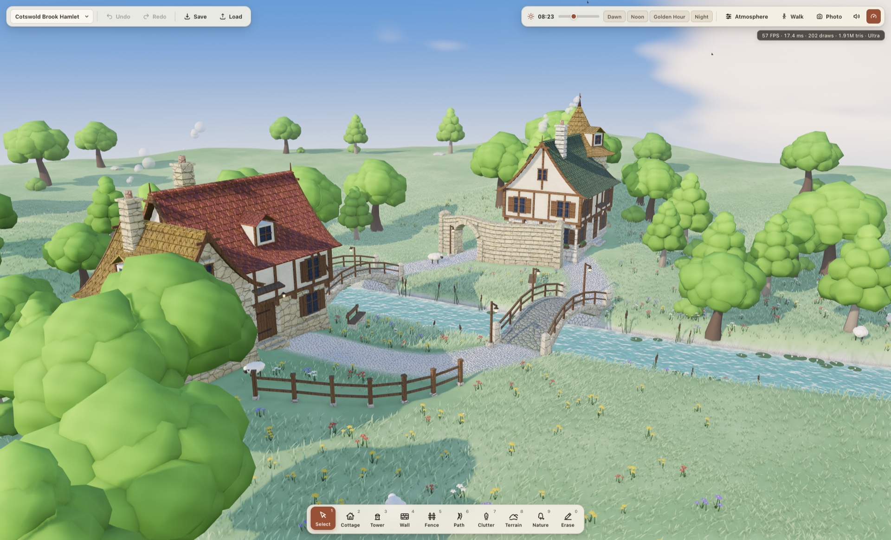<br/>
      <sub><b>科茨沃尔德溪畔村落</b> —— 都铎半木构造小屋与横跨 S 形溪流的双石拱桥</sub>
    </td>
  </tr>
  <tr>
    <td align="center" width="50%">
      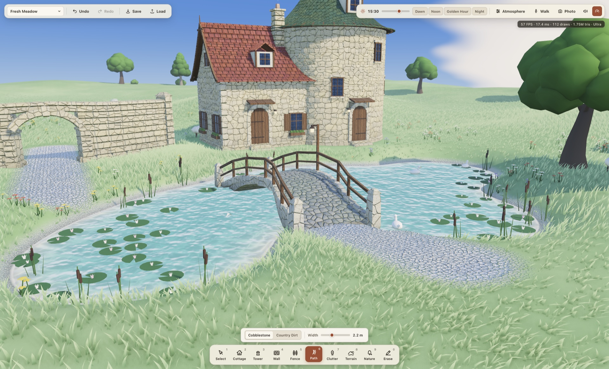<br/>
      <sub><b>水深感知池塘与自动建桥</b> —— Beer-Lambert 碧水吸收、岸边泡沫、睡莲香蒲与跨水自动拱桥</sub>
    </td>
    <td align="center" width="50%">
      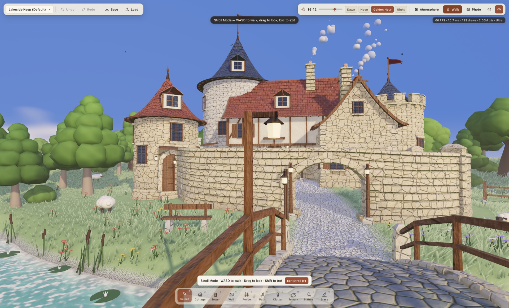<br/>
      <sub><b>第一人称漫步模式 (<code>F</code>)</b> —— 降至 <code>1.65 m</code> 视线高度，走过石拱桥、穿过自己建造的石拱门</sub>
    </td>
  </tr>
</table>

<details>
<summary><b>📸 展开查看全部 11 张实机渲染截图画廊 (Full 11-Screenshot Showcase)</b></summary>

<br/>

<table align="center">
  <tr>
    <td align="center" width="33%">
      <br/>
      <sub>1. 湖畔城堡（黄金时刻俯瞰）</sub>
    </td>
    <td align="center" width="33%">
      <br/>
      <sub>2. 星夜古堡（满月星夜）</sub>
    </td>
    <td align="center" width="33%">
      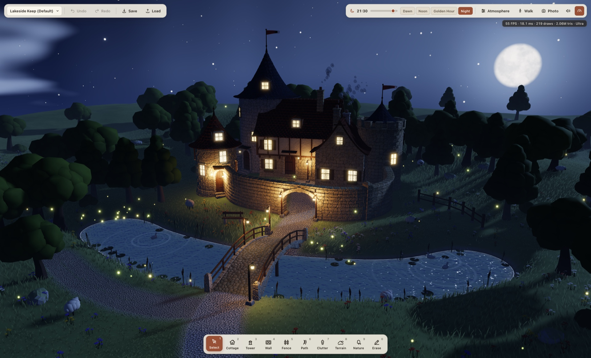<br/>
      <sub>3. 湖畔城堡（蓝调时刻与星空）</sub>
    </td>
  </tr>
  <tr>
    <td align="center" width="33%">
      <br/>
      <sub>4. 弧形石墙与自动拱门砖石特写</sub>
    </td>
    <td align="center" width="33%">
      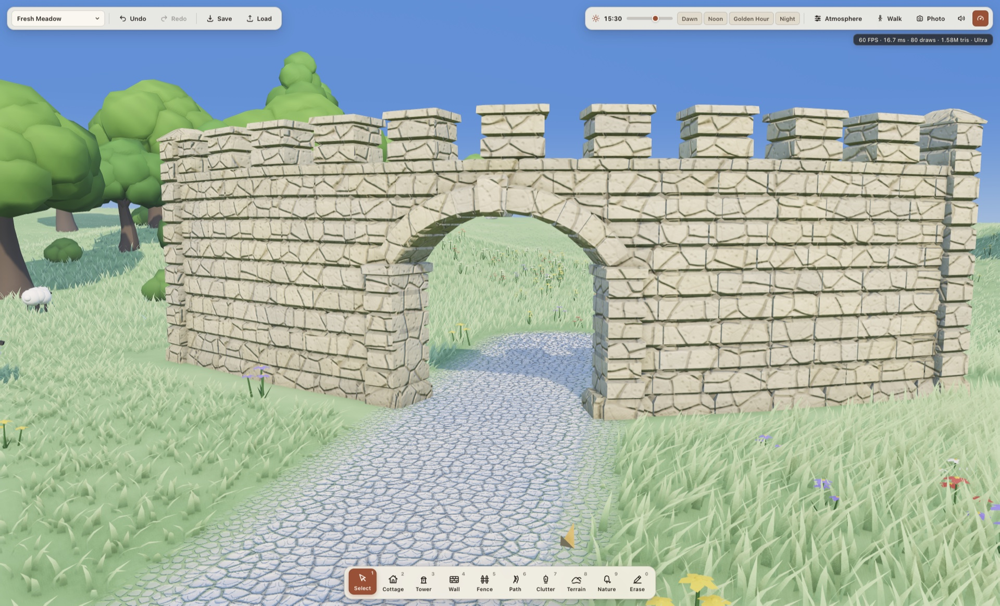<br/>
      <sub>5. 城垛雉堞高墙与拱门</sub>
    </td>
    <td align="center" width="33%">
      <br/>
      <sub>6. 科茨沃尔德溪畔村落预设</sub>
    </td>
  </tr>
  <tr>
    <td align="center" width="33%">
      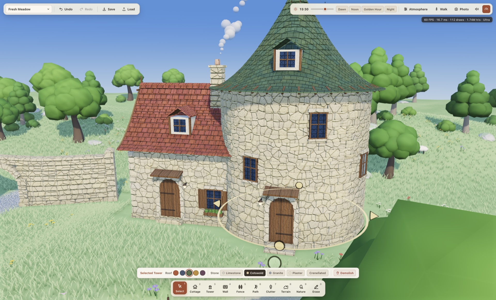<br/>
      <sub>7. 3D 实体手柄实时拉伸屋顶与塔身</sub>
    </td>
    <td align="center" width="33%">
      <br/>
      <sub>8. 实时挖塘注水与路径自动架桥</sub>
    </td>
    <td align="center" width="33%">
      <br/>
      <sub>9. 第一人称微缩漫步模式 (<code>F</code>)</sub>
    </td>
  </tr>
  <tr>
    <td align="center" width="33%">
      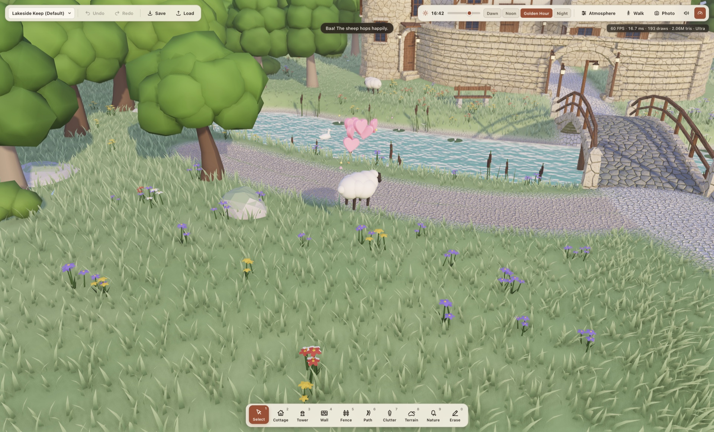<br/>
      <sub>10. 点击撸羊互动（欢跳咩叫 + 爱心粒子）</sub>
    </td>
    <td align="center" width="33%">
      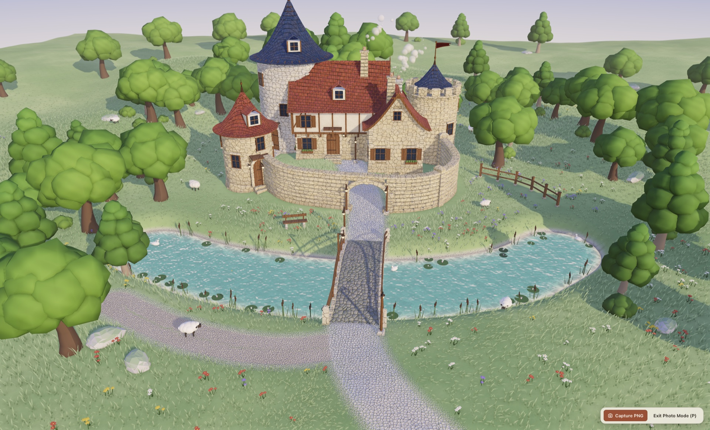<br/>
      <sub>11. 隐藏 HUD 纯净微缩摄影模式 (<code>P</code>)</sub>
    </td>
    <td align="center" width="33%">
      <a href="https://cdn.firetable.tech/file/tiny-glade-aaa.html"><b>▶ 立即在浏览器中打开体验</b></a><br/>
      <sub>交互式 WebGL2 HDR 微缩景观</sub>
    </td>
  </tr>
</table>

</details>

---

## 🚀 快速开始 (Quick Start)

### 方式 1：🌐 一键在线体验（免安装 · 秒开）
使用任意支持 WebGL2 的现代桌面或移动端浏览器（Chrome、Edge、Safari、Firefox）直接畅玩：

👉 **[https://cdn.firetable.tech/file/tiny-glade-aaa.html](https://cdn.firetable.tech/file/tiny-glade-aaa.html)**

### 方式 2：📄 零服务器本地双击运行（`file://` 离线即玩）
仓库已内置打包好的 100% 自包含单文件 `tiny-glade-aaa.html`（`929.6 KB`）以及 `index.html` + `dist/`，**无需安装 Node.js 或启动任何本地服务器**：

```bash
git clone https://github.com/FireTable/tiny-glade.git
cd tiny-glade

# macOS 终端直接打开单文件版（或在访达 / Windows 资源管理器中直接双击 tiny-glade-aaa.html）
open tiny-glade-aaa.html
```

### 方式 3：🛠️ 模块化源码构建与本地预览
如需修改 `src/` 下的模块化 ES2022 源码并重新构建 `dist/` 与单文件 `tiny-glade-aaa.html`（`esbuild` 耗时约 70 ms）：

```bash
# 1. 安装依赖 (three@0.170.0 + esbuild)
npm install

# 2. 构建 dist/glade.js、dist/glade.css 与单文件版 tiny-glade-aaa.html
npm run build

# 3. (可选) 启动本地静态预览服务器 -> http://localhost:8080
npm run preview
```

---

## ✨ 核心特性 (Key Features)

### 🔮 WebGL2 HDR 渲染与电影级后期管线 (`src/engine/`)
* **HalfFloat MSAA HDR 与 AgX 胶片色调映射**：全链路半精度浮点多重采样 HDR 渲染管线，配合自研 AgX 风格色调映射曲线，兼顾正午石灰岩高光层次与夜晚暖色灯笼辉光，绝不过曝死白。
* **瑞利 + 米氏物理大气散射与 24 小时昼夜天球**：支持 `00:00–24:00` 连续平滑过渡，实时渲染太阳圆盘、带环形山细节且无泛白过曝的月盘、闪烁星野，以及随晨昏散射染色的多层动态 FBM 积云。
* **节流动态 PMREM 环境光 (IBL) 与防抖阴影**：`PMREMGenerator` 从实时天空着色器动态烘焙 `scene.environment` 全局反射与漫反射，拖动时间滑块依然稳锁 60 FPS；主日光 `PCFSoftShadowMap`（Ultra `4096²` / High `2048²` / Balanced `1024²`）内置阴影纹素对齐（Texel Snapping），旋转镜头时阴影边缘零闪烁。
* **屏幕空间 GTAO、体积晨雾与自动对焦移轴景深 (Tilt-Shift DoF)**：真实感环境光遮蔽（GTAO）深入每一道石砖灰缝与屋檐阴影且无天空黑边，叠加体积丁达尔光束、山谷薄雾、HDR 局部泛光与微缩模型标志性的自动对焦移轴虚化。
* **水深感知 Beer-Lambert 水体系统 (`WaterSystem.js`)**：实时采样 `256×256` `HalfFloatType` 地形高度纹理，精确计算浅滩清透至深水翡翠绿的光吸收衰减、岸线动态白沫、菲涅尔天空反射、日月波光，以及天鹅游动与鼠标划水激起的实时涟漪。
* **100% 程序化 PBR 材质合成器 (`MaterialLibrary.js`)**：启动时在内存中动态生成 `512×512` 多级渐远（Mipmap）反照率、Worley/FBM 法线、粗糙度与 AO 贴图——涵盖石灰岩、科茨沃尔德暖石、花岗岩、都铎灰泥、5 色屋顶瓦片、木梁、鹅卵石、逆光次表面透射树叶，以及入夜自动亮起暖黄烛光并带窗棂视差的玻璃窗。

### 🏰 逐砖堆砌的响应式程序化建筑 (`src/arch/`)
* **倒角错缝石砌体与自适应斜坡基座**：石墙、小屋与圆塔均由独立 3D 倒角石块错缝砌筑，自带逐石冷暖色差、内凹深色灰浆层与加厚护坡石基座，在陡坡与池塘岸边自动向下扎根，零悬空缝隙。
* **标志性自动雕刻 3D 楔形拱石拱门 (`WallBuilder.js`)**：用鹅卵石路或乡间土路穿过任意直线、曲线、起伏或带城垛的 Catmull-Rom 石墙，交汇处即刻自动打通可穿行拱门，生成放射状 3D 楔形拱石（Voussoirs）、凸出拱顶石（Keystone）、两侧门柱，以及经二分搜索精确裁剪的零漏光拱肩砌石。
* **跨水自动生成石拱桥 (`BridgeAndClutter.js`)**：将路径画过任何池塘或溪流，系统自动架起弧形鹅卵石桥面、石砌桥头柱与弯曲木质护栏。
* **多翼融合农舍与圆柱城堡主楼 (`BuildingBuilder.js`)**：支持放置石砌/都铎半木结构小屋（含斜坡老虎窗）与圆形石塔（经典微翘“女巫帽”瓦顶或城垛平顶），建筑相交时自动融合为错落有致的复合城堡群。

### 🌿 生机盎然的风吹草甸、四季流转与野生动物 (`src/world/`)
* **最高 19.5 万株 GPU 实例化风吹草丛 (`FoliageSystem.js`)**：三叶簇状弧形草叶在 GPU 顶点着色器中随阵风波浪起伏，支持叶尖逆光透亮、**盛夏 / 金秋 / 初春**三季色彩切换，并自动剔除房屋室内地基、鹅卵石路面与水下区域的草叶。
* **吉卜力风团簇树冠、野花与水生植物**：多层团簇阔叶树与松柏支持阳光次表面散射，草甸点缀虞美人、毛茛、薰衣草与雏菊，池畔自动生长香蒲与浮水睡莲。
* **可互动撸羊、划水天鹅与氛围粒子 (`WildlifeAndParticles.js`)**：毛茸茸的绵羊在草地上悠闲吃草（**在选择模式下点击小羊即可抚摸互动**——触发开心蹦跳、飘起粉色爱心粒子与软萌咩叫！），天鹅在池面悠然划出圈圈水波，白昼彩蝶翩跹，入夜金色流萤飞舞，屋顶烟囱升起袅袅炊烟。

### 🎛️ 3D 实体交互手柄、第一人称漫步与程序化音效 (`src/game/` & `src/ux/`)
* **场景内 3D 拖拽手柄 (Gizmos)**：点击任意房屋或石墙即可在 3D 空间直接拖拽调整高度、屋顶坡度与弧度、占地长宽/半径、朝向角度，并实时切换墙体石材与瓦片配色。
* **第一人称微缩漫步模式 (`F`)**：一键从微缩俯瞰镜头平滑降至 `1.65 m` 真实人眼高度，沿着亲手铺设的石板路走上拱桥、穿过庭院石拱门。
* **100% WebAudio 程序化拟音与中世纪配乐 (`AudioEngine.js`)**：无需任何外部音频资源——拉墙铺路时触发音高随笔触递进的木琴/石块清脆敲击声、拆毁碎石声、水花声、小羊共振峰咩叫，以及随风力变化的微风声、白昼鸟鸣、夜晚虫吟与空灵的五声音阶竖琴/鲁特琴拨弦。
* **40 步撤销/重做、JSON 存档导入导出、4 套精选预设与纯净拍照模式 (`P`)**：内置*湖畔城堡*、*科茨沃尔德溪畔村落*、*星夜古堡*与*空旷草甸*四套预设，支持 JSON 存档分享与 `P` 键隐藏 UI 高清截图。

---

## 🎮 操作与快捷键 (Controls & Shortcuts)

### 微缩沙盘环绕镜头
| 输入 | 功能 |
| :--- | :--- |
| `右键拖拽` 或 `Alt + 左键拖拽` | 环绕旋转镜头（在 `1` 选择模式下拖拽空地同样可旋转镜头） |
| `中键拖拽` 或 `Shift + 右键拖拽` | 平移沙盘视野 |
| `鼠标滚轮` | 朝鼠标指向的地面位置平滑缩放 |
| `WASD` / `方向键` | 沿地面水平移动视野（按住 `Shift` 加速） |
| `Q` / `E` | 左右旋转镜头偏航角 |
| `Home` / `R` | 重置回全景俯瞰视角 |

### 第一人称微缩漫步模式 (`F`)
| 输入 | 功能 |
| :--- | :--- |
| `F` | 切换第一人称地面漫步模式（视线高度 `1.65 m`） |
| `左键拖拽` / `右键拖拽` | 自由环顾四周 |
| `WASD` / `方向键` | 沿石板路漫步、走上池塘石拱桥、穿过石墙拱门（按住 `Shift` 小跑） |
| `Esc` | 退出漫步模式，返回沙盘俯瞰镜头 |

### 建造与自然造景工具
| 快捷键 | 工具 | 交互说明 |
| :--- | :--- | :--- |
| `1` | **选择 / 编辑 (Select)** | 点击建筑或石墙呼出 3D 拉伸手柄与材质色板；点击绵羊或天鹅进行抚摸互动 |
| `2` | **小屋 / 大厅 (Cottage)** | 放置石砌或都铎木筋墙小屋；建筑重叠放置会自动融合成多翼城堡大厅 |
| `3` | **圆塔 (Tower)** | 放置圆柱形石塔，支持弧形微翘瓦顶或城垛雉堞顶 |
| `4` | **石墙 (Wall)** | 点击拖拽绘制弯曲石墙；与任意道路交叉时自动雕刻出 3D 楔形拱石拱门 |
| `5` | **木栅栏 (Fence)** | 点击拖拽绘制乡间木质围栏 |
| `6` | **道路 (Path)** | 涂抹鹅卵石路或乡间土路；穿墙自动开拱门，跨水自动建石拱桥 |
| `7` | **装饰物 (Clutter)** | 在墙面、屋顶与路旁吸附灯笼、窗户、木门、烟囱、旗帜、花箱或长椅 |
| `8` | **地形雕刻 (Terrain)** | 隆起山丘、降低地面、平滑坡度、平整台地，或开凿自动注水的池塘 (`Pond`) |
| `9` | **自然生态 (Nature)** | 种植吉卜力风团簇树、针叶松与草甸野花，或清理林间空地 |
| `0` | **拆除 (Erase)** | 移除建筑、石墙、道路、装饰或树木，伴随碎石烟尘粒子特效 |
| `Ctrl/Cmd + Z` / `Shift + Ctrl/Cmd + Z` | **撤销 / 重做** | 支持最多 40 步完整地形 + 建筑状态快照回退与重做 |
| `P` | **拍照模式 (Photo Mode)** | 一键隐藏所有界面按钮，导出高分辨率 PNG 截图 |
| `M` | **静音开关 (Mute)** | 开启 / 关闭程序化环境风声、鸟鸣虫吟、竖琴配乐与建造拟音 |

---

## ⚡ 性能实测基准 (Performance Benchmark)

实测环境：**Apple M1 Ultra**（macOS Chromium 156，`ANGLE Metal` 原生硬件 `WebGL 2.0`），视口尺寸 `1998 × 1212` CSS 像素（`devicePixelRatio = 2`），加载默认完整场景 **「湖畔城堡 (Lakeside Keep)」** 并连续执行 `3.5 秒` 平滑环绕运镜（累计验证超 `33,000` 帧实机渲染，**0 着色器编译警告、0 控制台报错、0 外部网络请求**）：

| 画质档位 | 渲染倍率 (`DPR`) | 实际物理像素分辨率 | 阴影贴图 | GPU 风吹草叶数 | Draw Calls | 三角面数 | 平均帧率（单帧耗时） |
| :--- | :---: | :---: | :---: | :---: | :---: | :---: | :---: |
| **Ultra（极致）** | `2.00` | `3996 × 2424` | `4096 × 4096` | `195,000` 株 | `208` | `2,062,245` | **56.0 FPS** (`17.87 ms`) |
| **High（默认高画质）** | `1.75` | `3496 × 2121` | `2048 × 2048` | `105,000` 株 | `208` | `1,586,142` | **60.0 FPS** (`16.67 ms`) |
| **Balanced（均衡）** | `1.25` | `2497 × 1515` | `1024 × 1024` | `48,000` 株 | `188` | `1,213,937` | **60.0 FPS** (`16.67 ms`) |

---

## 🛠️ 技术栈 (Tech Stack)

| 架构层 | 技术方案 | 说明 |
| :--- | :--- | :--- |
| **3D 渲染核心** | [Three.js `0.170.0`](https://threejs.org) (`WebGL2`) | `HalfFloatType` MSAA HDR 帧缓冲、`InstancedMesh` 砖石与植被实例化、`onBeforeCompile` 三平面 PBR 着色器增强 |
| **大气与水体** | 自研 GLSL ES 3.0 着色器 | 瑞利/米氏物理天空盒 + FBM 动态积云 + `PMREMGenerator` 实时环境光 + Beer-Lambert 深度吸收水体与涟漪 |
| **电影级后期** | 自研全屏后处理栈 (`PostFX.js`) | 屏幕空间 GTAO + 体积光束与山谷薄雾 + HDR 辉光 + 自动对焦微缩移轴景深 (Tilt-Shift DoF) + AgX 色调映射 |
| **程序化几何** | 原生 ES2022 (`src/arch/`) | 3D 倒角石块堆砌、Catmull-Rom 样条墙体、自动雕刻 3D 楔形拱门、二分裁剪斜切拱肩与自动跨水石拱桥 |
| **合成音频引擎** | 原生 `Web Audio API` (`AudioEngine.js`) | 100% 纯代码合成木琴砌砖音、风声滤波、鸟鸣虫吟、绵羊共振峰咩叫与中世纪五声音阶竖琴/鲁特琴 |
| **打包工具** | [esbuild](https://esbuild.github.io) (`build.mjs`) | ~70 ms 极速生成 `dist/glade.js` 开发包与 `929.6 KB` 零外部依赖单文件版 `tiny-glade-aaa.html` |

---

## 📂 项目结构 (Project Structure)

```text
tiny-glade/
├── tiny-glade-aaa.html            # 100% 自包含单文件 HTML 完整版 (929.6 KB —— 零外部依赖，双击即玩！)
├── swarm-making-of.html           # 1h41m 9-Agent Swarm 交互式甘特泳道图与全量上下文复盘报告
├── index.html                     # 本地开发 / 离线 HTML 入口 (加载 ./dist/glade.css 与 ./dist/glade.js)
├── styles.css                     # 温润羊皮纸与磨砂石板质感 HUD 样式表
├── build.mjs                      # esbuild 构建脚本，同步输出 dist/* 与单文件版 tiny-glade-aaa.html
├── package.json                   # 项目元信息与构建 / 预览脚本
├── public/
│   └── logo.png                   # 512×512 Tiny Glade 微缩景观应用图标
├── screenshots/                   # 11 张 1920×1164 实机验证 WebGL2 渲染截图
├── dist/
│   ├── tiny-glade-aaa.html        # 单文件自包含 HTML 副本
│   ├── glade.js                   # 未压缩 IIFE 构建产物，便于本地调试阅读
│   └── glade.css                  # 打包后的样式文件
└── src/
    ├── main.js                    # 启动引导、主渲染循环、地形/建筑/光源同步与历史栈编排
    ├── engine/
    │   ├── RendererPipeline.js    # WebGL2 HalfFloat MSAA HDR 渲染管线、画质档位与动态灯笼点光源池
    │   ├── AtmosphereSky.js       # 瑞利/米氏天空着色器、日月星辰、FBM 积云与节流 PMREM 动态环境光
    │   ├── MaterialLibrary.js     # 启动时 512×512 程序化 PBR 贴图合成与三平面青苔风化着色器
    │   ├── WaterSystem.js         # Beer-Lambert 深度吸收水体、岸线泡沫与天鹅/交互动态水波纹
    │   └── PostFX.js              # GTAO 环境光遮蔽、体积光雾、HDR Bloom、移轴景深与 AgX 色调映射
    ├── arch/
    │   ├── ArchitectureManager.js # 响应式建筑重算中枢（联动石墙、房屋、圆塔、道路与水桥）
    │   ├── GeometryUtils.js       # 3D 倒角石块生成、微翘女巫帽屋顶曲线与样条线段求交算法
    │   ├── WallBuilder.js         # Catmull-Rom 曲线石墙/木栏与自动雕刻 3D 放射状楔形拱石拱门
    │   ├── BuildingBuilder.js     # 多翼融合小屋、都铎半木墙体、圆柱主塔与斜坡自适应护坡石基
    │   └── BridgeAndClutter.js    # 跨水自动石拱桥及灯笼、窗户、木门、烟囱、旗帜、花箱、长椅
    ├── world/
    │   ├── WorldManager.js        # 地形、道路遮罩、建筑地基剔除、植被与野生动物统一管理器
    │   ├── TerrainSystem.js       # 256×256 可雕刻高度场、峭壁/岸滩/石板路 PBR 混合与 HalfFloat 高度图
    │   ├── FoliageSystem.js       # 最高 19.5 万株 GPU 风吹草甸、三季吉卜力团簇树、野花、睡莲与香蒲
    │   └── WildlifeAndParticles.js # 可抚摸绵羊、划水天鹅、蝴蝶、流萤、烟囱炊烟与拆除碎石粒子
    ├── ux/
    │   ├── HUDController.js       # 底部工具坞、上下文材质/笔刷浮层、天气镜头抽屉与纯净拍照模式
    │   ├── AudioEngine.js         # 100% WebAudio 程序化建造拟音、自然生灵声景与中世纪竖琴/鲁特琴
    │   ├── HistoryManager.js      # 40 步撤销/重做状态栈与 JSON 沙盘导入导出
    │   └── PresetScenes.js        # 4 套精选微缩场景预设（湖畔城堡 / 溪畔村落 / 星夜古堡 / 空旷草甸）
    └── game/
        ├── CameraController.js    # 临界阻尼沙盘环绕相机、屏幕中心自动对焦射线与 1.65 m 漫步相机
        └── InteractionController.js # 3D 空间拖拽手柄、贴地地形笔刷投影环与建造工具状态机
```

---

## 📄 许可证 (License)

本项目基于 **[MIT 许可证](LICENSE)** 开源（`Copyright (c) 2026 FireTable`）。

本仓库内所有 3D 几何体、WebGL2 着色器、PBR 表面贴图与 WebAudio 音效均由代码在运行时 100% 程序化实时生成，不包含任何专有或第三方商业美术/音频素材。

---

## 🙏 致谢 (Acknowledgements)

* **[Pounce Light — *Tiny Glade*](https://pouncelight.games/tiny-glade/)**（*Anastasia Opara & Tomasz Stachowiak*）—— 向原版 *Tiny Glade* 致以最诚挚的敬意！其开创性的无网格响应式程序化砖石建筑与宁静治愈的微缩景观美学是本项目的直接灵感来源，强烈推荐在 Steam 支持正版原作。
* **[Three.js](https://threejs.org)** —— 支撑自定义 WebGL2 HDR 渲染与着色器管线的核心 3D 引擎。
* **[esbuild](https://esbuild.github.io)** —— 极速构建并内联输出单文件便携式 HTML。
* **Google DeepMind Gemini 4 Carbon** —— 仅凭单条用户提示词端到端构建了完整的渲染引擎、程序化砖石几何、着色器、交互 UI 与 WebAudio 合成器。
